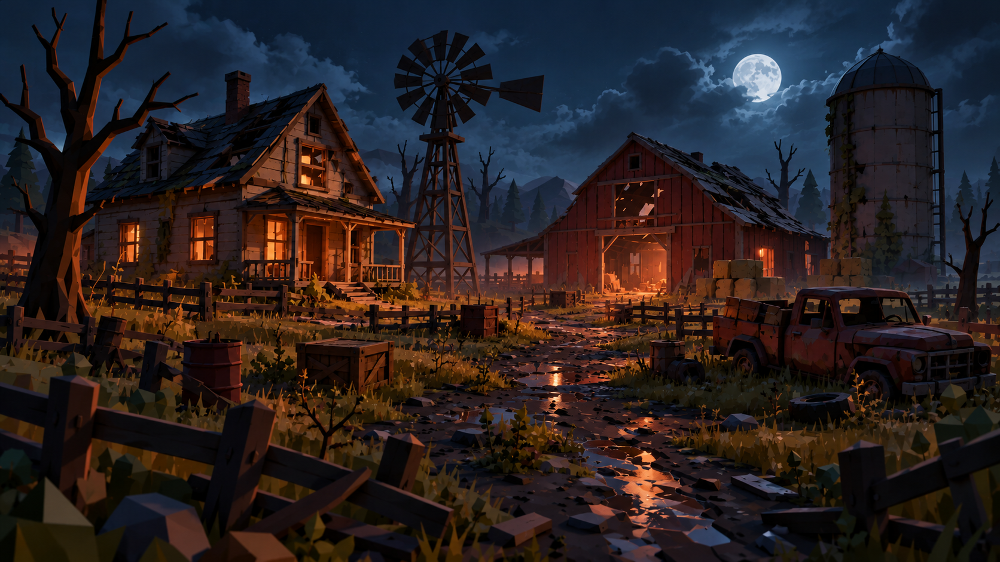

# Fazenda — referência visual aprovada

Imagem fornecida pelo usuário em 24/10/2026. Prioridade sobre a referência
anterior de pôr do sol para composição, arquitetura, paleta e atmosfera.
Este documento orienta a produção; não indica que os modelos já foram criados.

## Composição observada

- Casa de dois pavimentos à esquerda, tábuas acinzentadas, telhado escuro
  inclinado e quebrado, chaminé, água-furtada e varanda com pilares e corrimão.
- Moinho alto de torre treliçada entre casa e celeiro, rotor com pás metálicas
  irregulares e cauda larga. A silhueta se destaca contra o céu.
- Celeiro vermelho à direita do centro, porta grande aberta, abertura no sótão,
  telhado deteriorado e interior iluminado. É o destino visual da estrada.
- Silo cilíndrico alto na extrema direita, cúpula facetada, anéis, escada lateral,
  ferrugem e trepadeiras. Fardos de feno na base.
- Caminhonete enferrujada em primeiro plano à direita, com frente voltada para
  a câmera e carroceria com caixas. Pneus soltos e barris ao redor.
- Árvore seca grande em primeiro plano à esquerda, cercas quebradas na borda
  inferior e no meio da cena, caixas, pedras e vegetação baixa irregular.
- Estrada central de lama com pedras e poças refletindo a iluminação quente;
  o caminho converge para a entrada do celeiro.
- Montanhas facetadas, coníferas, árvores mortas, névoa e nuvens em camadas.

## Luz, materiais e câmera

Noite azul-escura, lua cheia no alto à direita e luz laranja saindo das janelas,
da varanda e do celeiro. Preservar contraste quente/frio e sombras profundas,
mantendo legibilidade de silhuetas. O céu ocupa aproximadamente a terça parte
superior da composição, com estruturas se projetando sobre ele.

Geometria facetada com detalhes médios e altos: tábuas individuais, telhas
faltantes, bordas irregulares e manchas de ferrugem. Evitar reduzir os prédios
a blocos lisos. A imagem mistura geometria low poly com iluminação elaborada;
a fidelidade depende de ambas. Não usar cores emissivas em toda a madeira:
limitar emissão às fontes de luz e aberturas.

A câmera deve mostrar o pátio em perspectiva, com profundidade de primeiro
plano até as montanhas, proporção de imagem próxima a 16:9. Coordenadas,
dimensões absolutas e distância focal não são conhecidas pela imagem e devem
ser ajustadas comparando capturas no Studio. Uma única imagem não determina
as fachadas ocultas nem os interiores; esses serão extrapolados de forma coerente.

## Ordem de produção

Integrar a arte ao mapa existente em `src/server/Systems/FarmMap.luau`;
não criar um mapa substituto do zero. O módulo já monta casa, celeiro, silo,
cercas, decoração e iluminação no início do servidor. Preservar os pontos de
gameplay e suas tags (`Barricade`, `ZombieSpawn`, `ClimbZone`, `TurretSlot`,
`ShopBox`, `AmmoBox`, `Extraction`, `ShootThrough`, `Flicker`).
Começar pela aparência sem alterar o layout de navegação. Mudanças posteriores
de layout exigem conferir o flow field, as barricadas e os pontos de interação.

1. Modelar volumes e silhuetas da casa e do celeiro no Blender, seguidos do
   moinho e do silo. Usar a mesma escala entre os quatro modelos.
2. Montar os volumes no Studio e fixar câmera de comparação com a referência.
3. Conferir distância entre prédios, alturas, telhados e área livre da estrada.
4. Refinar madeira, telhados, varanda, aberturas, torre e cúpula.
5. Acrescentar caminhonete, cercas, árvore principal, caixas, barris e vegetação.
6. Ajustar terreno, poças, noite, luzes quentes, céu e névoa; comparar capturas.

A primeira versão serve para validar composição e proporções. O acabamento
e a fidelidade visual serão avaliados em capturas do motor. Preservar os
requisitos de navegação e as tags do gameplay durante a integração.
