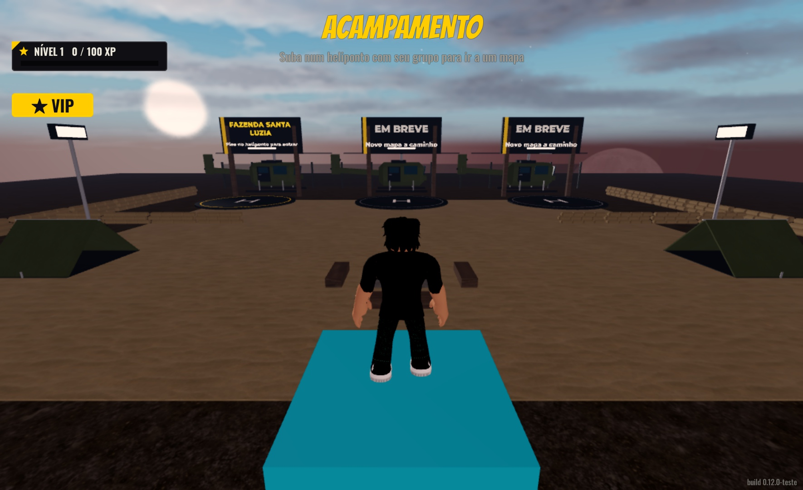

# Integração do kit — 26/10/2026

## Entrega

69 imagens enviadas ao Roblox e registradas em
`src/shared/Art/AssetIds.luau` e `assets/game/published-images.json`.
Os 10 modelos do kit foram importados no Studio como 107 MeshParts com IDs
reais, normalizados da escala de importação 100× para studs e recoloridos.
O resultado é versionável em `assets/models/OutbreakKit.rbxmx`, incluído nos
dois projetos Rojo como `ReplicatedStorage.OutbreakKit`.

O import original foi preservado no `ServerStorage` do Studio confirmado,
fora do cenário, como backup. Não é necessário para construir os projetos:
o arquivo rbxmx e os IDs publicados contêm o kit normalizado.

## Onde aparecem

| Superfície | Integração |
|---|---|
| HUD de combate | Ícones de vida/créditos e miniatura da arma, atualizada com o loadout |
| Loja | Oito miniaturas, lista rolável, preços separados, estados por saldo/nível e debounce de compra |
| Classes | Emblemas de Gunslinger e Exterminador |
| Progressão | Ícone de XP e botões com estados; posição de conta ajustada no hub |
| Resultado / fase | Ícones de troféu e onda |
| Touch | Ícones com rótulos preservados e superfícies normal/pressionada nos controles existentes |
| Painéis / botões | Texturas 9-slice; texto separado e legível durante carregamento; foco e indisponibilidade |
| Hub | Barracas, caixas, módulos de sacos de areia, refletores, helipontos, helicópteros e placas |
| Embarque | Ícone de helicóptero; fundo do hub na tela de teleporte; overlay removido na falha de inicialização |
| Granada | Malha soldada ao projétil existente, massless e sem colisão, consulta ou toque |
| Torreta | Base visual estática e três malhas superiores acompanhando a cabeça por weld |
| Loja no mundo | Kit médico e granada como exposição decorativa sobre a caixa |
| VFX | Máscaras próprias para fumaça, flash, faísca e partículas suaves; emissores reutilizados |

Os pontos de gameplay do hub mantêm seus nomes e atributos. Os volumes de
fila continuam 18×8×18 nas posições originais. O `SurfaceGui` das placas
mantém o caminho esperado pelo `PortalService`, com `Adornee` apontando para
a nova placa. Os refletores usam luz Roblox real. As peças visuais não criam
colisão, eventos de toque nem alvos de raycast; os colisores anteriores continuam
responsáveis pela navegação.

O helicóptero do hub continua estático. O helicóptero de extração, as sete
armas equipadas e os zumbis mantêm seus sistemas e modelos anteriores. A nova
prancha de frente/costas do zumbi é uma referência 2D, não uma malha pronta
para substituir o rig animado.

## Verificação executada

No Studio do hub, place `77549309919854`:

- Bootstrap de servidor e cliente sem novos erros de script.
- Dez modelos de origem / 107 MeshParts sincronizados pelo Rojo.
- 66 instâncias de arte no hub, com 796 peças e nenhuma colisão/consulta/toque.
- Três portais com posição e tamanho preservados; fila 1/4 ao entrar e
  cancelamento ao sair do heliponto.
- Carregamento das 69 imagens confirmado via `ContentProvider:PreloadAsync`
  com instâncias `ImageLabel` (69 callbacks de sucesso).
- Texto dos botões visível mesmo antes da textura carregar; o primeiro teste
  identificou e corrigiu uma dependência inadequada do evento de `IsLoaded`.

Na fazenda, usando uma cópia temporária construída por `rojo build` (place 0):

- Servidor e cliente iniciaram, com HUD, classes e loja usando as imagens.
- Loja aberta por `ProximityPrompt` real, com oito itens e rolagem de 640 unidades.
- Compra de escopeta refletida no texto, munição e miniatura do HUD.
- Granada lançada pelo remote real: três MeshParts decorativas, hitbox esférica
  de 0,8 stud preservada e propriedade de rede no servidor.
- Torreta instalada pelo prompt real: quatro malhas fixas e três móveis,
  soldadas à cabeça, sem colisão/consulta/toque adicional.
- Três flashes consecutivos não aumentaram o número de emissores já alocados.
- Composição touch exercitada numa fixture de 667×375 e 844×390: todos os
  oito controles mantiveram rótulos; alvo mínimo de 48 e 49,92 unidades.
- Loja em uma área de 667×375: janela de 586,96×322,5, oito botões com
  altura de 48 e lista rolável de 562,96×246,5.

A fixture de touch força a construção dos controles dentro de uma área com
essas dimensões. Ela não substitui teste em celular físico nem validação de
latência, gestos e desempenho em aparelho. Os testes temporários, créditos de
QA e ForceField existiram só durante Play e foram descartados ao encerrar.
Os switches `Config.DEBUG` não foram alterados.

Checagens locais: ambos os projetos Rojo construíram; Selene e StyLua passaram
nos arquivos alterados; `git diff --check` passou. Há dois avisos anteriores à
integração: DataStore indisponível no Studio (modo offline já previsto) e o som
`203785492` com tipo inválido. Esses avisos não foram ocultados nem tiveram
permissões alteradas.

## Publicação e limites

Em 27/10/2026, os assets foram integrados ao place Fazenda real
`99300600626141`, preservando Weapons (33 descendentes), Zombies (17),
Props (17) e Heroes (91). Os scripts anteriores estão em
`qa/release/farm-sources-before.json` (snapshot da versão 9; os comprimentos
dos scripts continuavam iguais na versão 11 antes da integração).

Publicação confirmada no Creator Dashboard com o filtro **Mostrar apenas
publicadas**: acampamento `77549309919854` na versão **66** e Fazenda
`99300600626141` na versão **12**. Provas em `qa/release/`.

O lançamento público foi concluído após a confirmação do criador de que
o jogo não contém violência explícita ou gore. O Creator Dashboard confirmou
disponibilidade para jogadores maiores de 16 anos, sujeita às restrições de
maturidade. Prova em `qa/release/public-release-confirmed.png`.
O acesso para menores de 16 anos e mais regiões permanece condicionado às
etapas adicionais indicadas pelo Roblox (identidade, verificação em duas
etapas, questionário e requisitos de alcance/publicação). Nenhuma taxa foi
paga nem configuração de segurança da conta alterada.

O ícone gerado foi salvo em ambos os places. A capa foi enviada à Fazenda
e à experiência principal; na principal, foi ativada na Página inicial e
enviada à Página de detalhes da experiência. A exibição depende da moderação
de imagens do Roblox.

Play no place Fazenda real: servidor e cliente iniciaram, 16 legendas de
botões e 39 elementos de imagem foram encontrados na interface; os modelos
Medkit e Grenade foram criados no mapa. O verificador confirmou 10 modelos,
107 MeshParts e 69 IDs de imagem. Os avisos anteriores de DataStore offline
e áudio `203785492` persistem.
Teleportes reais entre places precisam de teste na experiência publicada,
pois o Studio não oferece o mesmo fluxo de teleporte.

## Reproduzir e manter

1. Os projetos Rojo incluem `assets/models/OutbreakKit.rbxmx`; não é preciso
   reimportar FBXs em cada place. Manter os IDs na conta dona da experiência.
2. `tools/design/record-upload.py` transforma os resultados de upload em IDs
   Luau e atualiza o manifesto. Não executa novos uploads.
3. `tools/design/export-published-models.py` reconstrói o rbxmx a partir dos
   IDs e transforms verificados em `hub/published-meshes.json`.
4. O gerador de catálogo preserva os IDs existentes. Regenerar imagens não
   publica versões novas automaticamente: fazer upload e registrar os novos IDs.
5. `tools/studio/verify-asset-kit.luau` faz uma verificação somente de leitura
   do kit, IDs, portais e rótulos dos botões no Studio.
6. `tools/blender/pack-game-kit.py` e `tools/studio/install-asset-kit.luau`
   documentam o import inicial. O instalador exige que o kit ainda não exista,
   para evitar substituir modelos já integrados sem inspeção.
