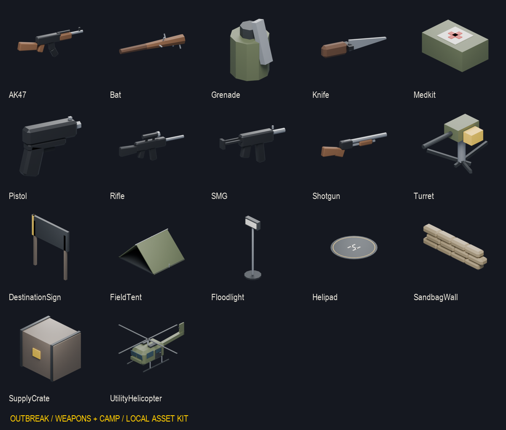
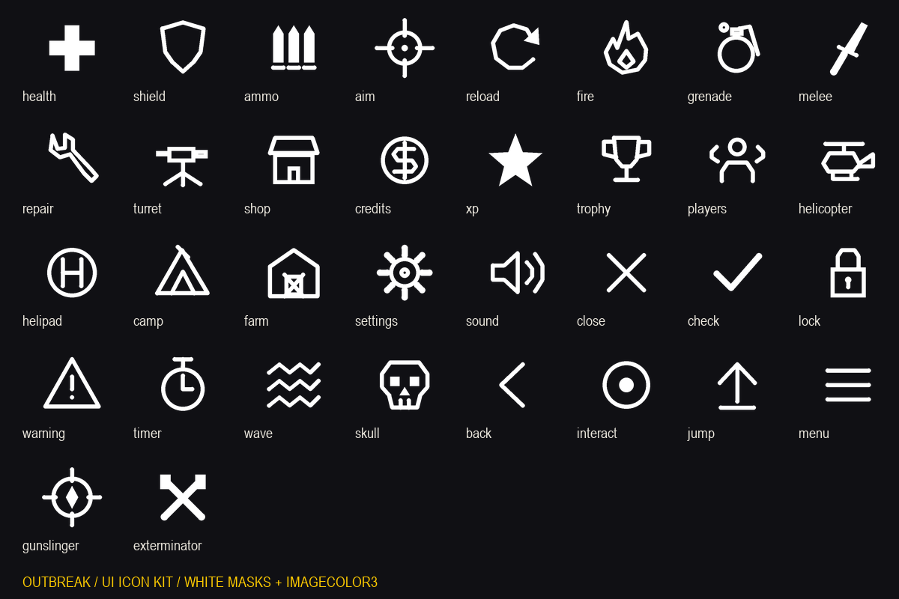

# Outbreak — kit de assets v0.1

**Atualização de 26/10/2026:** kit integrado aos dois projetos Rojo, com
69 imagens publicadas e 107 MeshParts importadas. O estado atual e os testes
estão em [Integração do kit](ASSET-INTEGRATION.md). As seções de produção abaixo
descrevem a entrega inicial; as pendências de importação foram resolvidas nessa integração.

Criado em 25/10/2026 para complementar o [design system](DESIGN-SYSTEM.md).
Arquivos finais em `assets/game/`, sem substituir as artes e modelos anteriores.
O kit tem 76 PNGs de uso, 34 fontes SVG, 10 modelos FBX novos e um projeto
Blender editável. Pranchas de revisão e metadados são adicionais.

## Arte do jogo

| Arquivo em assets/game | Uso | Estado |
|---|---|---|
| marketing/outbreak-cover-v1.png | Capa horizontal: fazenda, quatro sobreviventes e horda | Arte gerada, revisão editorial antes de publicar |
| marketing/outbreak-icon-v1.png | Ícone quadrado do jogo: rosto de zumbi e celeiro | Arte gerada, revisão em tamanho pequeno |
| backgrounds/hub-loading-v1.png | Fundo de carregamento do acampamento | Ilustração, não captura do mapa |

Artes feitas com a ferramenta integrada ImageGen. Prompts completos em
[`assets/game/prompts.json`](../../assets/game/prompts.json). Os originais foram
preservados nas dimensões entregues pelo gerador; o manifesto registra as
dimensões reais. Não são exports finais certificados para os campos do Creator
Dashboard. Ajustar o formato exigido pelo destino quando forem publicados.
Imagens são material promocional/conceitual e não representam fidelidade
comprovada do jogo em execução. O fundo ilustrado sugere uma direção noturna;
a iluminação do hub atual não foi alterada.

## Armas e equipamentos



| Arquivos em weapons/ | Entrega |
|---|---|
| Pistol.png, SMG.png, Shotgun.png, Rifle.png, AK47.png | Ícones 512×512 com alpha, renderizados dos modelos existentes |
| Knife.png, Bat.png | Ícones 512×512 com alpha, renderizados dos modelos existentes |
| Grenade.png + Grenade.fbx | Novo modelo low poly e render transparente |
| Medkit.png + Medkit.fbx | Novo modelo low poly e render transparente |
| Turret.png + Turret.fbx | Novo modelo low poly e render transparente |

Os modelos das sete armas já existem em `assets/source/weapons.blend` e
`assets/export/weapons.fbx`; não foram recriados nem trocados. Seus ícones
agora usam a mesma geometria do jogo. As três peças novas são meshes estáticas,
sem lógica de dano, disparo, cura ou interação. A cruz do kit é um detalhe de
material; seu uso e aparência final podem ser ajustados no fonte.

## Kit 3D do hub

Cada peça tem um FBX e uma prévia PNG 512×512 em `assets/game/hub/`.

| Peça | Triângulos | Detalhe |
|---|---:|---|
| SupplyCrate | 48 | Caixa de suprimentos, faixas metálicas e marcador amarelo |
| SandbagWall | 528 | Módulo de três fileiras de sacos de areia |
| FieldTent | 180 | Barraca em A, lona, piso e estrutura |
| Floodlight | 112 | Base, poste e refletor; luz real deve ser adicionada no Studio |
| DestinationSign | 48 | Placa de destino sem texto, para receber SurfaceGui |
| Helipad | 544 | Base, perímetro amarelo e H geométrico |
| UtilityHelicopter | 408 | Helicóptero estático com cabine, janelas, portas, patins e rotores |

Fonte editável: `hub/hub-and-equipment.blend`, com uma coleção por peça, todas
na origem. Coleções ficam ocultas no render para evitar sobreposição; habilitar
apenas a peça que estiver editando. FBXs já foram exportados individualmente.
Convenção de export: frente -Z e cima Y; 1 unidade de modelagem segue a escala
do pipeline existente. Conferir escala no importador antes de usar no mapa.

São peças de base low poly para composição. O helicóptero não tem rig,
animação ou voo. Não substituem automaticamente o `HubMap` procedural, nem
incluem volumes de fila, tags ou pontos de spawn. Colisão e interação continuam
sob controle dos sistemas existentes.

## Interface



34 ícones originais, em PNG transparente 256×256 e SVG editável:

- Combate: health, shield, ammo, aim, reload, fire, grenade, melee, repair, turret.
- Economia e progresso: shop, credits, xp, trophy.
- Hub e equipe: players, helicopter, helipad, camp, farm.
- Sistema: settings, sound, close, check, lock, warning, timer, wave, skull,
  back, interact, jump, menu.
- Classes: gunslinger e exterminator.

PNG dos ícones é uma máscara branca: aplicar `ImageColor3` usando os tokens
do tema. Exemplo: `player` para estado pronto, `accent` para comprar e `text`
para ações neutras. Ícone shield é reservado; não significa que existe um
sistema de escudo. Não expor ações sem suporte de gameplay.

15 fundos de botão 64×64: famílias primary, secondary e touch, cada uma com
normal, hover, pressed, disabled e focused. Não têm texto embutido: preço,
idioma, tecla e nome da ação continuam sendo elementos separados.

Três painéis 64×64: hud, modal e warning. Fundo opaco no arquivo, para que
`ImageTransparency` controle a transparência em runtime. Uso sugerido:

```lua
image.ScaleType = Enum.ScaleType.Slice
image.SliceCenter = Rect.new(12, 12, 52, 52)
image.SliceScale = 1
```

As coordenadas de slice também estão em `ui/slices.json`. Preservar alvos de
toque do design system: imagem de 64×64 não limita o tamanho do botão.
Estado visual não desabilita interação sozinho: atualizar também o controlador.
Elementos nativos de GUI continuam adequados para barras e texto.

## Partículas

Quatro máscaras brancas transparentes 256×256 em `vfx/`: soft-particle,
smoke, muzzle-flash e spark. Definir cor, tamanho, emissão, duração e
transparência no `ParticleEmitter` usando as cores semânticas do jogo.
São fontes procedurais originais, sem áudio e sem preset de partículas
integrado. Evitar aumentar emissões para cada zumbi da horda.

## Catálogo e importação

[`assets/game/manifest.json`](../../assets/game/manifest.json) registra caminho,
tipo, dimensão, alpha, tamanho e hash SHA-256 de cada arquivo. As 69 imagens
publicadas têm seus IDs registrados; prévias e referências continuam locais. O relatório de meshes em
`hub/model-report.json` inclui bounds e orçamento de triângulos.

`src/client/UI/Assets.luau` fornece chaves estáveis, por exemplo
`ui.icons.ammo`, `weapons.AK47` e `backgrounds.hub-loading-v1`. `Assets.FILES`
é um índice de arquivos para desenvolvimento; caminho local não funciona na
propriedade `Image` do Roblox. Após upload, fornecer IDs reais para resolver:

```lua
local image = Assets.resolve("ui.icons.ammo", publishedIds)
if image then
    ammoIcon.Image = image
end
```

`publishedIds` é um mapa de chaves para IDs numéricos retornados pelo upload.
O resolver retorna nil para uma chave não publicada, sem inventar IDs.
`AssetView` usa os IDs de `Shared.Art.AssetIds`, mantém rótulos separados e
aplica imagens aos controladores listados no relatório de integração.

Ordem de integração:

1. Importar PNGs e FBXs na conta/grupo proprietário da experiência e registrar
   IDs válidos. Conferir moderação e disponibilidade na experiência.
2. Conferir escala, orientação, materiais e pivôs dos FBXs. Separar colisores
   simples e desativar colisão/consulta/toque nos detalhes decorativos.
3. Integrar ícones e estados aos componentes existentes, mantendo rótulos,
   acessibilidade, validação do servidor e controle de entrada sob modais.
4. Compor o hub usando seus pontos de gameplay atuais; placa recebe texto
   dinâmico e refletor recebe luz Roblox. Preservar zona de teleporte.
5. Verificar PC/mobile no Studio, contraste em combate, alcance dos dedos,
   transparência e leitura das armas em tamanho pequeno.

## Cobertura do jogo e próximos assets

| Área | Já disponível | Ainda requer produção ou validação |
|---|---|---|
| Armas | Set 3D anterior + novos ícones e equipamentos | Animações de recarga/segurar e importação das peças novas |
| Hub | Kit modular novo + HubMap existente | Composição, colisão, luz real, animação do rotor e revisão no Studio |
| UI | Ícones, botões, painéis, tokens e catálogo | Aplicação aos HUDs e navegação por controle |
| Divulgação | Capa, ícone e fundo do hub | Export por destino, revisão e publicação |
| Zumbis/personagens | FBX, fontes e rigs anteriores em assets/source e assets/export | Conferir animações e LOD em execução; sem novo personagem nesta entrega |
| Fazenda | Arte e modelos anteriores no projeto | Continuar o acabamento conforme direção aprovada |
| VFX | Quatro máscaras novas | Presets e orçamento de partículas em aparelho |
| Áudio | Catálogo existente em src/shared/Art/Sounds.luau | Produção/licenciamento de sons definitivos e mixagem |

O kit cobre a base visual solicitada. Não substitui a produção de animações,
áudio. A integração posterior publicou as imagens, importou as malhas e
validou o hub e uma cópia local da fazenda no Studio; ver o relatório atual.

## Reproduzir

- `tools/blender/game_asset_kit.py`: Blender, gera meshes e renders; requer os
  fontes existentes das armas. Nesta entrega foi usado Blender 5.2.3 LTS.
- `tools/design/build-ui-assets.py`: Python/Pillow, gera SVGs, PNGs de UI e VFX.
- `tools/design/catalog-assets.py`: Python/Pillow, verifica os PNGs, cria o
  manifesto, catálogo Luau e prancha de modelos. Executar depois dos geradores.
- `stylua src/client/UI/Assets.luau` após regenerar o catálogo.

Validação executada: render e revisão visual das pranchas, decodificação dos
76 PNGs iniciais e presença de alpha nos recortes, export dos 10 FBXs, relatório de
triângulos e Selene/StyLua nos módulos de UI. A integração posterior validou
importação e uso em execução conforme o [relatório de integração](ASSET-INTEGRATION.md).
