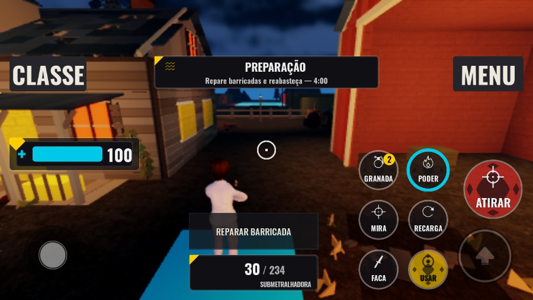
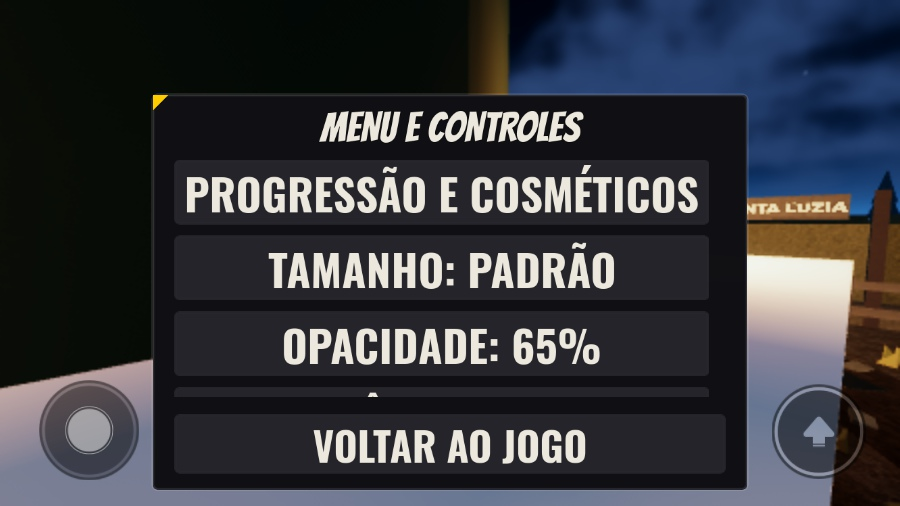

# HUD responsivo — implementação e verificação

Concluído em 28/10/2026. Escopo: controles mobile da Fazenda, infraestrutura compartilhada com o acampamento e regressão de apresentação no PC. Os arquivos do projeto e os builds locais estão atualizados. Esta sessão não publicou mudanças na Roblox.

## Implementação

- `UI/ControlLayout.luau`: cálculo puro de retângulos por largura/altura útil, com perfis compacto, celular amplo e tablet. Reservas de movimento e pulo, limites, separação e largura legível da munição são verificados antes de escolher o perfil. O modo ampliado recua para o tamanho padrão se não couber e informa essa condição no menu.
- `UI/Layout.luau`: um observador compartilhado da área segura e do pulo nativo; não acompanha os gráficos móveis do analógico. Eventos de redimensionamento são agrupados, sem recalcular geometria a cada frame.
- `MobileHUD.luau`: alvos de toque separados da aparência dos botões; criação tardia ao disponibilizar touch; gesto pertence ao controle onde começou; tiro compartilha o arrasto com a câmera nativa; interação libera sua posse quando o prompt desaparece.
- `UI/TouchRouter.luau` e `UI/ActionState.luau`: posse por dedo e por fonte de entrada; liberar uma fonte não libera outra que continua pressionada.
- `InputController.luau`: limpeza em menus, mudança de entrada, perda de foco e remoção do personagem. Prompts nativos também ficam suspensos durante modais e recuperam seu estado anterior ao fechar.
- Vida e munição usam o mesmo cálculo dos controles. O texto completo da interação tem uma região própria; o botão permanece com o rótulo curto USAR. No touch, a interface contextual substitui o prompt padrão enquanto está visível, restaurando seu estilo quando necessário.
- Menu com rolagem: tamanho, opacidade, sensibilidade normal/ao mirar, mira alternar/segurar, disparo automático e restauração do padrão. Preferências são locais à sessão; não há persistência entre sessões nem editor livre de posições.
- O compartilhamento da câmera conserva o controle nativo; a preferência de sensibilidade ajusta a rotação produzida por ele, sem aplicar um segundo delta de arrasto.

## Evidências automatizadas

Comandos executados:

```sh
luau tests/mobile-controls.luau
luau-analyze src/client/UI/ControlLayout.luau src/client/UI/TouchRouter.luau src/client/UI/ActionState.luau tests/mobile-controls.luau
selene src tools/studio/verify-hud.luau tests/mobile-controls.luau
git diff --check
rojo build default.project.json -o docs/design/qa/hud-fazenda.rbxlx
rojo build hub.project.json -o docs/design/qa/hud-acampamento.rbxlx
```

- 624 combinações de largura/altura e tamanho padrão/ampliado passaram, além de casos com geometria do pulo fornecida explicitamente.
- Testes de posse: dedo não transfere ação ao cruzar outro botão; dois dedos não disputam o mesmo controle; liberar movimento não libera tiro; cancelamento é idempotente; sumir um prompt libera a interação; um dedo antigo não libera uma nova interação.
- Testes de fontes: liberar touch não encerra uma ação ainda mantida pelo mouse; limpeza libera todas as ações.
- Análise Luau dos módulos puros e testes sem erros; Selene sem erros/avisos; StyLua nos arquivos do HUD e diff sem problemas.
- Builds dos dois projetos concluídos.

## Teste no Studio

Executado em uma cópia local construída do projeto da Fazenda, `wwz-hud-responsive.rbxlx`, preservando os places em uso. Servidor e cliente iniciaram corretamente. O diagnóstico antigo de código do acampamento dentro da Fazenda não foi observado nesta cópia atual.

Para medir a interface sem interrupções de ondas/morte, parte dos testes usou uma preparação mantida por um script temporário, proteção do personagem e um ProximityPrompt de teste. Esses auxiliares existiram somente no Play e foram removidos ao encerrá-lo; não estão nos fontes nem nos builds. As capturas são do runtime real, mas esse cenário controlado não substitui uma partida completa.

| Dispositivo emulado | Área segura observada | Resultado |
| --- | --- | --- |
| iPhone 7 | 666 × 316 | 14 elementos, zero cortes/sobreposições/alvos pequenos |
| Samsung Galaxy A06 | 705 × 280 | 14 elementos, zero cortes/sobreposições/alvos pequenos |
| iPhone 17 Pro, paisagem direita | 750 × 323 | 14 elementos, zero cortes/sobreposições/alvos pequenos |
| iPad 6ª geração | 1023 × 710 | 14 elementos, zero cortes/sobreposições/alvos pequenos |
| Average Laptop | Ver JSON de evidências | HUD touch oculto; 5 elementos de PC sem cortes/sobreposições |

As dimensões são as áreas úteis observadas no Studio, não a resolução física nominal dos aparelhos. O iPhone 17 Pro também foi conferido em paisagem esquerda e com controles ampliados: tiro de 91 × 91 e ações de 62 × 62, sem sobreposição. O pulo nativo permaneceu visível nos perfis mobile.

Interações verificadas com entrada simulada do Studio:

1. Confirmar classe e pressionar PRONTO pelos botões reais.
2. Segurar tiro: ação mantida e feedback de pressão ativo.
3. Arrastar esse dedo sobre a granada: câmera mudou, tiro continuou e nenhuma granada foi acionada.
4. Soltar fora do tiro: ação e feedback liberados.
5. Iniciar arrasto fora do tiro e cruzá-lo: não disparou.
6. Tocar mira: estado alternado; abrir menu liberou a mira e ocultou os controles.
7. Menu curto: conteúdo rolável de 544 unidades em região de 176, com botão de retorno acessível.
8. Segurar USAR por 0,75 s sobre prompt de 0,5 s: uma interação recebida no servidor.
9. Abrir modal durante interação pendente: prompts desabilitados, zero interações no servidor durante a janela e prompts restaurados ao fechar.

O verificador `tools/studio/verify-hud.luau` agora registra retângulos reais, área segura, tipo de entrada, visibilidade, limites, tamanho mínimo dos alvos e sobreposições. `hud-responsive-matrix.json` contém os resultados finais por dispositivo.

## Capturas e builds





- `hud-fazenda.rbxlx`: build local atualizado do mapa.
- `hud-acampamento.rbxlx`: build local atualizado do hub.
- `hud-responsive-studio-before.json`: cópia anterior dos scripts da primeira etapa de sincronização.

## Limites e estado final

- Play da cópia local encerrado e simulador restaurado ao dispositivo padrão.
- O place real da Fazenda estava em Play por outro trabalho ao terminar; não foi interrompido nem substituído por esta sessão. Os ajustes finais estão nos arquivos e builds locais.
- Não houve publicação nesta sessão. O acampamento foi compilado, mas não houve um novo playtest completo dele nesta etapa.
- Permanecem os avisos anteriores de DataStore offline no Studio e áudio `203785492` de tipo incompatível, sem erro novo dos módulos de HUD nos testes.
- Falta avaliação de alcance/fadiga em aparelhos físicos, multitouch físico com dois polegares, multiplayer e partida completa em desempenho reduzido. Os testes de posse automatizados e o arrasto emulado não comprovam sozinhos esses aspectos.
- Alterações paralelas de armas, pose e atalhos de PC foram preservadas; a verificação descrita aqui cobre o HUD, não certifica essas outras frentes.
